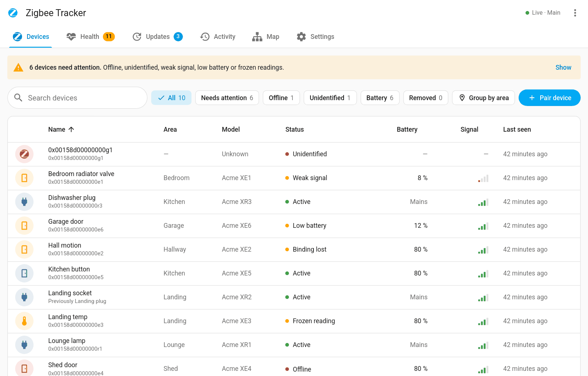
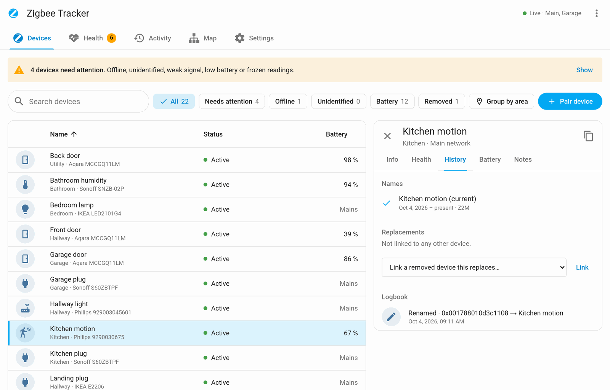
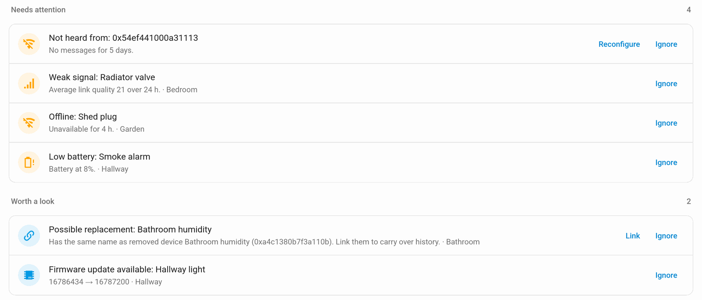
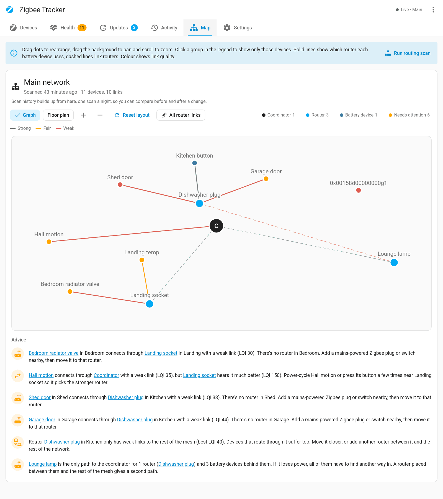
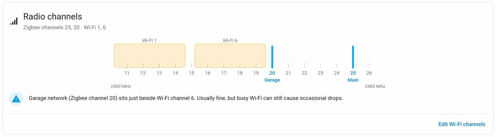

<h1 align="center">Z2M Device Tracker</h1>

<p align="center">
  <strong>History, health and alerts for every Zigbee2MQTT device.</strong>
</p>

<p align="center">
  <a href="https://github.com/tempus2016/z2m-device-tracker/releases"></a>
  <a href="https://hacs.xyz/docs/faq/custom_repositories/"></a>
  <a href="https://github.com/tempus2016/z2m-device-tracker/blob/main/LICENSE"></a>
  
  
</p>

<p align="center">
  <a href="https://github.com/tempus2016/z2m-device-tracker/actions/workflows/lint.yml"></a>
  <a href="https://github.com/tempus2016/z2m-device-tracker/actions/workflows/app.yml"></a>
  <a href="https://github.com/tempus2016/z2m-device-tracker/actions/workflows/hassfest.yml"></a>
  <a href="https://github.com/tempus2016/z2m-device-tracker/actions/workflows/hacs.yml"></a>
  <a href="https://github.com/tempus2016/z2m-device-tracker/actions/workflows/codeql.yml"></a>
  <a href="https://github.com/tempus2016/z2m-device-tracker/commits/main"></a>
</p>

A Home Assistant app and integration that keeps a full history of every device on your Zigbee2MQTT networks, watches their health, and tells you when something needs attention.

Ever had a device show up as `0x30eb5affff5cf5ca` and had no idea what it used to be? This records every name, model, area and change, and keeps it after the device is gone.

<p align="center"></p>

It has two parts, both in this repository:

| Part | What it does | Install from |
| --- | --- | --- |
| **App** (`z2m_tracker/`) | Listens to Zigbee2MQTT over MQTT, stores the history and runs the web interface in the sidebar. | Settings → Apps → App store → Repositories |
| **Integration** (`custom_components/z2m_tracker/`) | Optional. Adds summary sensors, a dashboard card and Repairs issues. | HACS (custom repository) |

## Features

- **Device history**: names, renames, model, firmware, area, joins, leaves and removals, with notes and asset details.
- **Health checks and alerts**: offline, silent, frozen readings, weak or dropping signal, low battery, failed interviews, unidentified devices. Alerts go to HA notifications, events or a notify service.
- **More checks**: flapping devices, chatty devices, fast battery drain, lost bindings, single points of failure (routers), and a missing, stale or mismatched coordinator backup. They show in Health and only notify once you turn them on.
- **Bindings and traffic**: each device's current and lost bindings with a history of changes, its message rates, and Zigbee2MQTT's own message, leave and address-change counters.
- **Coordinator health**: Zigbee2MQTT version, coordinator firmware, uptime, restarts, outages and coordinator backup, and an alert when a network goes offline.
- **Radio channels**: shows your Zigbee channels against your 2.4 GHz Wi-Fi channels and warns about overlap.
- **Network map**: interactive map with advice on which router a device should use and which routers are a single point of failure, nightly routing scans, and a before/after comparison between scans.
- **Device actions**: pair through a chosen router, move a device to another router, reconfigure, rename, set area, OTA updates.
- **Firmware updates**: one list of every device with an update, installed and available versions, update all one device at a time, an optional overnight window that skips low batteries, and a log of past updates.
- **Batteries**: battery type and count (built-in library from Battery Notes), replacement records, estimates and a shopping list.
- **Home Assistant entities**: MQTT discovery sensors attached to each Zigbee2MQTT device for use in automations.
- Weekly summary, temporary ignore, backup and restore, CSV export.

## Screenshots

<table>
  <tr>
    <td width="50%" valign="top"><br><b>Device history</b>: a device's names and logbook, kept after it leaves</td>
    <td width="50%" valign="top"><br><b>Health</b>: what needs attention, and what's worth a look</td>
  </tr>
  <tr>
    <td width="50%" valign="top"><br><b>Network map</b>: routing, link quality and advice on better routers</td>
    <td width="50%" valign="top"><br><b>Radio channels</b>: Zigbee channels against your Wi-Fi channels</td>
  </tr>
</table>

The screenshots use made-up demo devices. More are in the [wiki](https://github.com/tempus2016/z2m-device-tracker/wiki).

## Install the app

[](https://my.home-assistant.io/redirect/supervisor_add_addon_repository/?repository_url=https%3A%2F%2Fgithub.com%2Ftempus2016%2Fz2m-device-tracker)

1. Settings → Apps → App store → ⋮ → Repositories, add `https://github.com/tempus2016/z2m-device-tracker`.
2. Install **Z2M Device Tracker** and start it. It needs the Mosquitto broker (or another MQTT broker set up in HA).
3. Open **Zigbee Tracker** from the sidebar.

If your Zigbee2MQTT uses a different base topic, or you run more than one instance, set `base_topics` in the app's configuration. See the app's Documentation tab for every option.

## Install the integration (optional)

[](https://my.home-assistant.io/redirect/hacs_repository/?owner=tempus2016&repository=z2m-device-tracker&category=integration)

1. HACS → ⋮ → Custom repositories, add `https://github.com/tempus2016/z2m-device-tracker` as **Integration**.
2. Download **Z2M Device Tracker** and restart Home Assistant.
3. Settings → Devices & services → Add integration → **Z2M Device Tracker**. The app's address is filled in for you.

The integration also lists the app's problems in **Settings → Repairs**, and clears each one when it's fixed. Turn this off in the integration's options.

Add the card to a dashboard:

```yaml
type: custom:z2m-tracker-card
title: Zigbee devices
max_items: 5
```

## Contributing

Bug reports and ideas go in the [issues](https://github.com/tempus2016/z2m-device-tracker/issues). For code, see [CONTRIBUTING.md](CONTRIBUTING.md), and report security problems privately as described in [SECURITY.md](SECURITY.md).

## Credits

The battery library is from [Battery Notes](https://github.com/andrew-codechimp/HA-Battery-Notes) by Andrew Jackson (MIT licence, see `z2m_tracker/app/battery_library.LICENSE`).

## Licence

MIT
