<h1 align="center">Z2M Device Tracker</h1>

<p align="center">
  <strong>History, health and alerts for every Zigbee2MQTT device.</strong>
</p>

<p align="center">
  <a href="https://github.com/tempus2016/z2m-device-tracker/releases"></a>
  <a href="https://github.com/tempus2016/z2m-device-tracker/releases"></a>
  <a href="https://my.home-assistant.io/redirect/marketplace_repository/?owner=tempus2016&repository=z2m-device-tracker&category=integration"></a>
  <a href="https://github.com/tempus2016/z2m-device-tracker/blob/main/LICENSE"></a>
  
  
</p>

<p align="center">
  <a href="https://github.com/tempus2016/z2m-device-tracker/actions/workflows/lint.yml"></a>
  <a href="https://github.com/tempus2016/z2m-device-tracker/actions/workflows/app.yml"></a>
  <a href="https://github.com/tempus2016/z2m-device-tracker/actions/workflows/hassfest.yml"></a>
  <a href="https://github.com/tempus2016/z2m-device-tracker/actions/workflows/hacs.yml"></a>
  <a href="https://github.com/tempus2016/z2m-device-tracker/actions/workflows/codeql.yml"></a>
  <a href="https://github.com/tempus2016/z2m-device-tracker/commits/main"></a>
</p>

A Home Assistant app and integration that keeps a full history of every device on your Zigbee2MQTT networks, watches their health, and tells you when something needs attention.

Ever had a device show up as `0x30eb5affff5cf5ca` and had no idea what it used to be? This records every name, model, area and change, and keeps it after the device is gone.

<p align="center">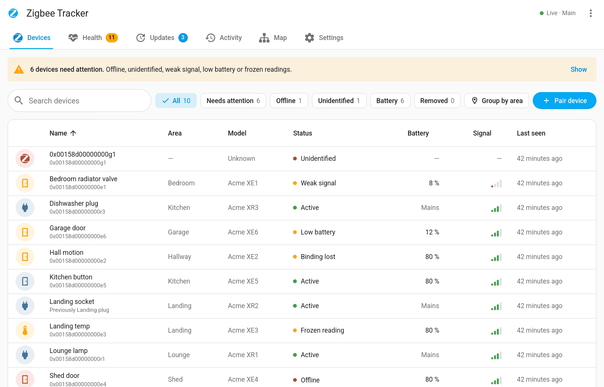</p>

> [!IMPORTANT]
> **New in 2.0: rate your Zigbee devices and help everyone choose better ones.**
> Open a device in the sidebar, go to its **Community** tab and press **Share your experience**. Pick Recommend, It's OK or Avoid, add tags or a comment, and choose whether to attach the uptime, drop-outs, link quality and battery life the tracker measured. The tracker fills in a GitHub issue form for you. Nothing is posted until you press **Create** on GitHub, and no names, areas or addresses are ever included. **Upkeep → Community** lists the models on your network that nobody has rated yet. Every report makes the ratings more useful for the next person buying a sensor. You can also [rate a device on GitHub](https://github.com/tempus2016/z2m-device-tracker/issues/new?template=device_rating.yml) directly.

## Two parts, installed in two places

Z2M Device Tracker comes in two parts, and they install from different places in Home Assistant. Both live in this repository.

| Part | Needed? | What it does | Where to get it |
| --- | --- | --- | --- |
| **1. App** (`z2m_tracker/`) | **Yes** | Does the actual tracking. It listens to Zigbee2MQTT, keeps the history and gives you the **Zigbee Tracker** page in the sidebar. | **Settings → Apps → App store**, after adding this repository. It isn't in the Marketplace. |
| **2. Integration** (`custom_components/z2m_tracker/`) | Optional | Brings the app's data into Home Assistant: summary sensors, a battery to-do list and calendar, a dashboard card and Repairs issues. | **Settings → Marketplace** (HACS before Home Assistant 2026.11) |

> [!IMPORTANT]
> Start with the app. The integration only shows what the app has collected, so on its own it does nothing. If you found this page in the Marketplace, install the app first ([step 1](#step-1-install-the-app)), then come back for the integration ([step 2](#step-2-install-the-integration-optional)).

## Features

- **Device history**: names, renames, model, firmware, area, joins, leaves and removals, with notes and asset details.
- **Health checks and alerts**: offline, silent, frozen readings, weak or dropping signal, low battery, failed interviews, unidentified devices. Alerts go to HA notifications, events or a notify service. Set how often each device should report, mark smoke and leak sensors as critical so they alert within minutes, hold alerts overnight for one morning summary, and pause them all during planned work. Devices behind a router that goes offline arrive as one alert, not dozens. Phone alerts get buttons to mute for 24 hours, ping or record a battery change, and each problem shows which Home Assistant automations, scripts and scenes use the device.
- **More checks**: flapping devices, chatty devices, fast battery drain, lost bindings, single points of failure (routers), end devices that keep changing router, routers getting slower, Zigbee group members offline, a daily network-wide signal dip, pairing left open, Zigbee2MQTT memory growth, and a missing, stale or mismatched coordinator backup, commands a device answers slowly or misses, reporting settings that drain a battery or flood the mesh, names that don't follow your naming pattern, overdue maintenance, and a network that got worse after an upgrade. They show in Health and only notify once you turn them on.
- **Bindings and traffic**: each device's current and lost bindings with a history of changes and a Restore button for each lost one, its message rates, and Zigbee2MQTT's own message, leave and address-change counters.
- **Coordinator health**: Zigbee2MQTT version, coordinator firmware, uptime, restarts, outages and coordinator backup, how Zigbee2MQTT reaches the coordinator, Zigbee2MQTT's own memory and MQTT traffic, and an alert when a network goes offline, a history of changes to Zigbee2MQTT's own settings, and the week before each Zigbee2MQTT or firmware upgrade compared with the week after.
- **Radio channels**: shows your Zigbee channels against your 2.4 GHz Wi-Fi channels and warns about overlap.
- **Network map**: interactive map with advice on which router a device should use and which routers are a single point of failure, nightly routing scans, a before/after comparison between scans, and a floor-plan layout that groups devices by Home Assistant floor and area. Pick a router and ask "What if it goes?" to see which devices would move, to which router, and which have no other router in range. The map also names the top three areas where an extra plug-in router would help most. Click a group in the legend (routers, battery devices, needs attention) to show only those devices, hide names you don't need, and show only the problem links on the floor plan.
- **Device actions**: pair through a chosen router with each new device followed through its interview and named from your pattern, move a device to another router, ping a mains device, reconfigure, rename, set area, OTA updates. Find and remove Zigbee2MQTT devices left behind in Home Assistant. Names and areas stay in step with Home Assistant: a change made there shows in the app within seconds.
- **Incidents**: related problems on a network grouped into one entry with a likely cause, such as a router going offline and the devices behind it following.
- **Firmware updates**: one list of every device with an update, installed and available versions, update all one device at a time, an optional overnight window that skips low batteries, and a log of past updates.
- **Replace a device**: swap a dead device, or a working one you want to change (another brand or model), for a new one in three steps. The new device takes over its name, area, bindings, notes and, if you want, battery record, the old one is removed from Zigbee2MQTT, and both histories are linked.
- **Batteries**: battery type and count (built-in library from Battery Notes), replacement records with an optional brand (and a comparison of how long each brand lasts), estimates and a shopping list that counts the spares you have in stock. With the integration, the shopping list is a Home Assistant to-do list (tick an item to mark those batteries replaced) and a calendar shows each predicted replacement date.
- **Maintenance tasks**: recurring jobs per device, such as testing a smoke alarm monthly or cleaning a leak sensor every 6 months, with suggestions by device type. The Health tab lists what is overdue or due in the next 14 days, and an overdue task shows as a check. With the integration, they are a second to-do list (tick to mark done) and calendar.
- **Community ratings**: what other Zigbee Tracker users think of each device model (Recommended, Mixed or Avoid, from at least 5 reports), with their measured uptime, drop-outs, link quality and battery life next to yours. **Share your own from a device's Community tab**: it opens a pre-filled GitHub issue, with your stats only if you choose. The ratings are public under CC0 and also feed a "Rated poorly by others" health check and an optional section on the summary card.
- **Reliability by model**: your own devices grouped by model, with uptime, dropouts, battery life and failed pairings, worst first.
- **Mesh score**: one 0 to 100 score per network at the top of Health, from devices online, link quality, backup routes and open problems, with a 30-day trend and a Home Assistant sensor.
- **MQTT broker**: Mosquitto statistics (clients, retained messages, dropped messages, messages per minute), stale retained messages left under old or removed device names with Clear, retained `/set` commands that replay on every restart, and Zigbee2MQTT availability that disagrees with what a device is actually sending.
- **Data quality**: a live Messages tab on each device, impossible readings (a 300 °C sensor, humidity stuck at 100%), devices that start sending different data after a firmware or converter change, and advice when Zigbee2MQTT's `last_seen` is off.
- **Alerts that get answered**: power loss in an area spotted as one incident, serious problems in Home Assistant Repairs, and escalation to a second phone when nobody answers an alert in time.
- **Assets and costs**: warranty end dates, running costs from device and battery prices, device age with when its firmware last changed, printable QR labels (Avery L7651 sheets or 29 mm tape), and two devices compared side by side.
- **More than one network**: a network picker with an All networks overview, mesh score per network, versioned coordinator backup copies with what changed between them, Zigbee group history, reporting profiles instead of typing an interval per device, and your own firmware notes that hold back a bad update.
- **Long-range trends**: each device's link quality and battery over 24 hours, 7, 30 or 90 days, with a daily min–max band, battery changes and a projection to when the battery runs low.
- **Home Assistant entities**: MQTT discovery sensors attached to each Zigbee2MQTT device for use in automations.
- **Prometheus metrics**: an optional token-protected `/metrics` endpoint for Grafana and similar tools.
- **Actions for automations** (integration): record a battery change, mute a device, run a network scan, reconfigure, start a firmware update, add to a device's note, pause and resume alerts. Pick devices by name.
- **Your language**: the sidebar, the dashboard cards and the setup screens follow the language in your Home Assistant profile, or one you pick in Settings. Available in English, German, Dutch, French, Spanish, Italian, Polish, Brazilian Portuguese, Swedish, Czech, Russian and Simplified Chinese. [CONTRIBUTING.md](CONTRIBUTING.md) explains how to add or fix a translation.
- **Works on a phone**: a bottom tab bar with Health, Devices, Network and Upkeep, and the rest under More, problems first, pinch zoom on the map, and keyboard and screen reader support on every screen.
- Weekly summary, temporary ignore, backup and restore, CSV export.

## Screenshots

<table>
  <tr>
    <td width="50%" valign="top">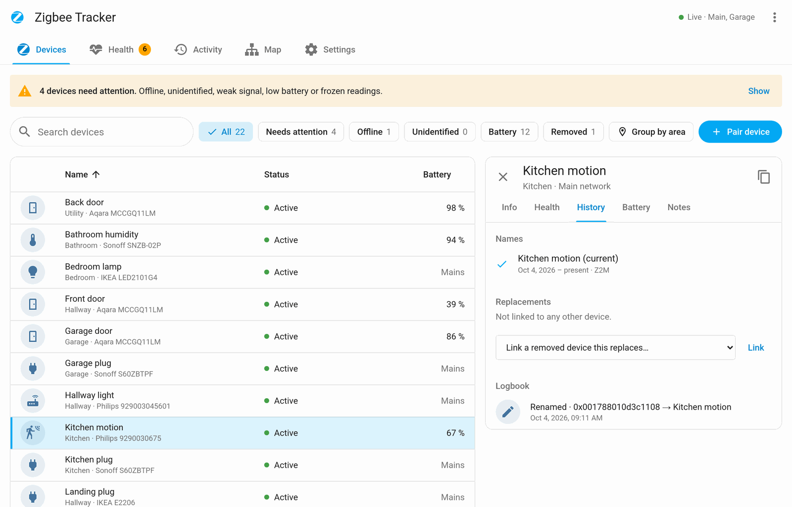<br><b>Device history</b>: a device's names and logbook, kept after it leaves</td>
    <td width="50%" valign="top">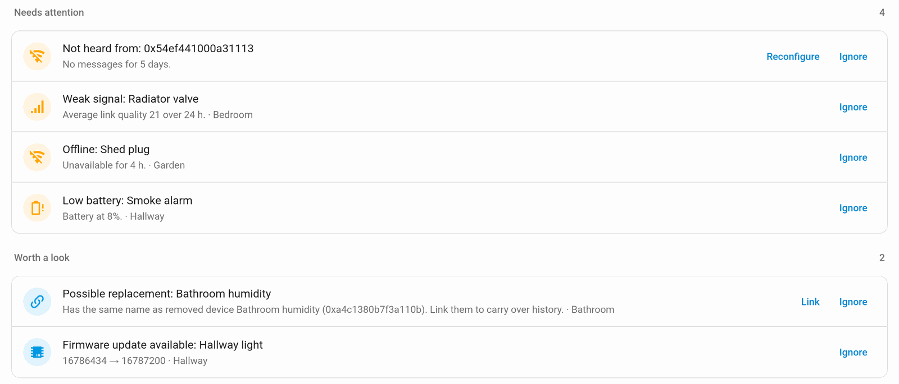<br><b>Health</b>: what needs attention, and what's worth a look</td>
  </tr>
  <tr>
    <td width="50%" valign="top">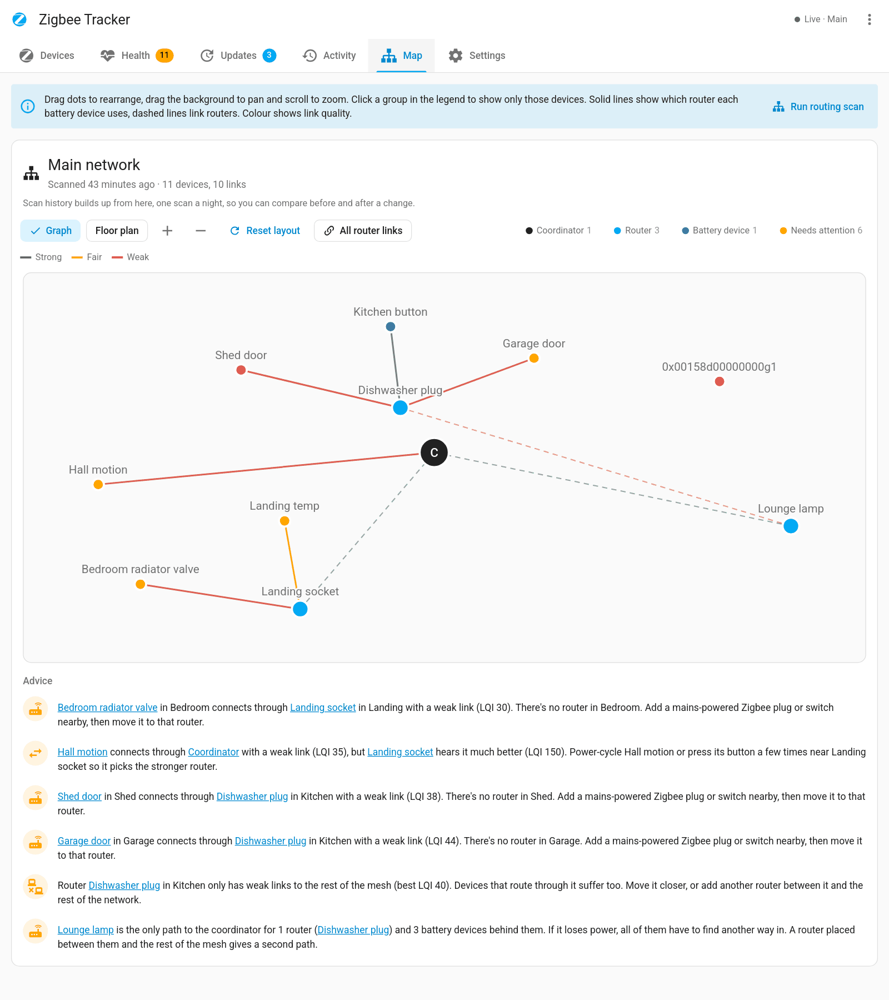<br><b>Network map</b>: routing, link quality and advice on better routers</td>
    <td width="50%" valign="top">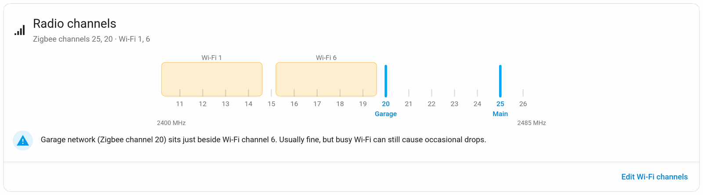<br><b>Radio channels</b>: Zigbee channels against your Wi-Fi channels</td>
  </tr>
  <tr>
    <td width="50%" valign="top">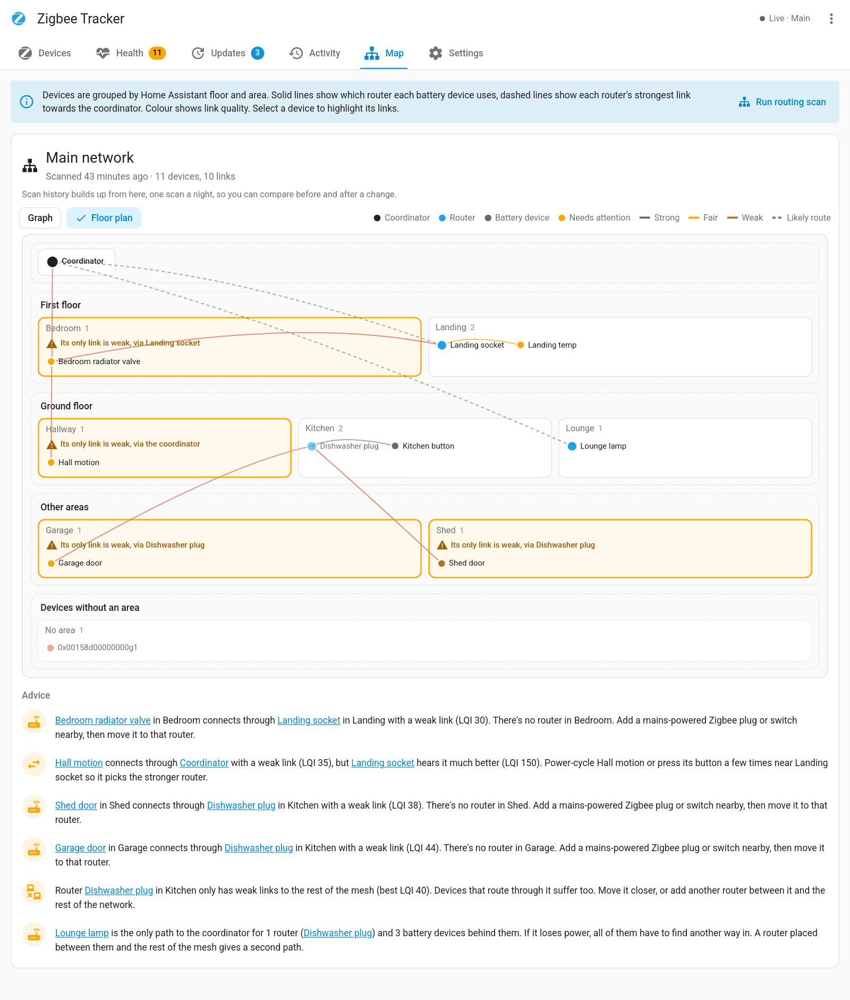<br><b>Floor plan</b>: devices by floor and area, with weak areas flagged</td>
    <td width="50%" valign="top">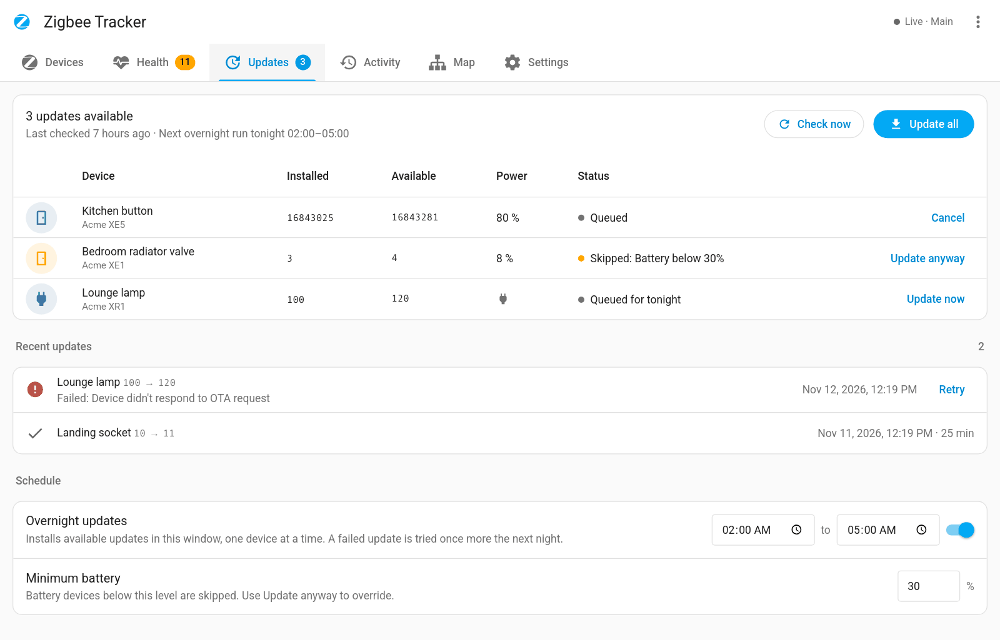<br><b>Firmware updates</b>: every update in one list, with an overnight window</td>
  </tr>
  <tr>
    <td width="50%" valign="top">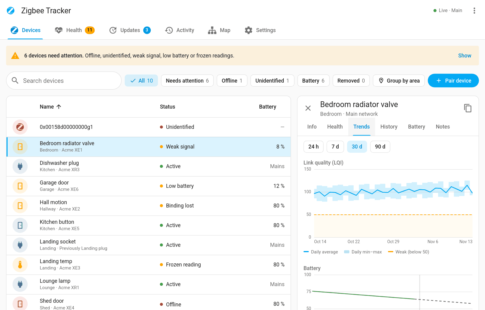<br><b>Trends</b>: link quality and battery over up to 90 days</td>
    <td width="50%" valign="top">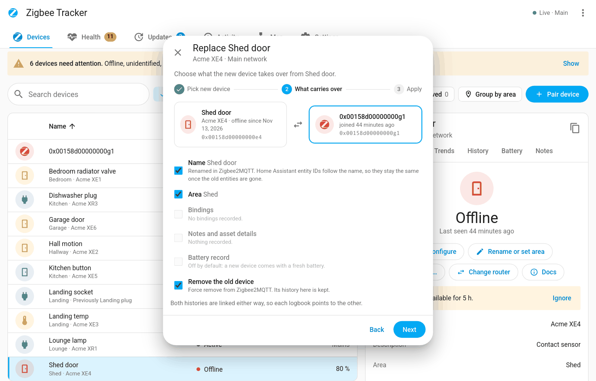<br><b>Replace a device</b>: the new one takes over name, area and setup</td>
  </tr>
  <tr>
    <td width="50%" valign="top">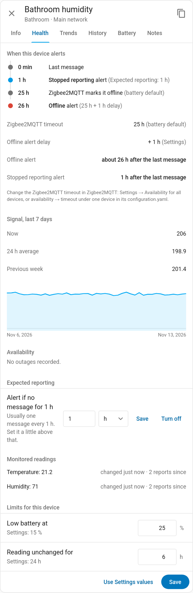<br><b>When a device alerts</b>: expected reporting and per-device limits</td>
    <td width="50%" valign="top">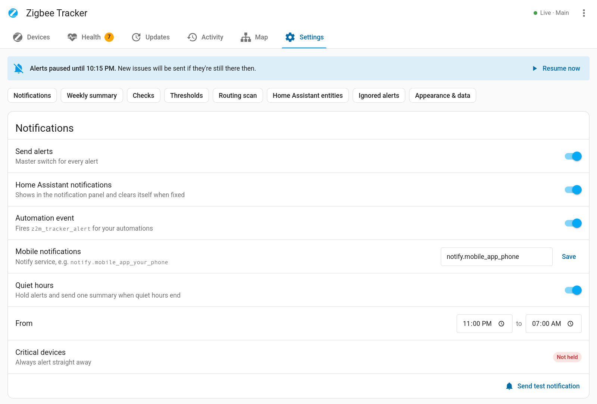<br><b>Quiet hours and pause</b>: hold alerts overnight, pause during planned work</td>
  </tr>
  <tr>
    <td width="50%" valign="top">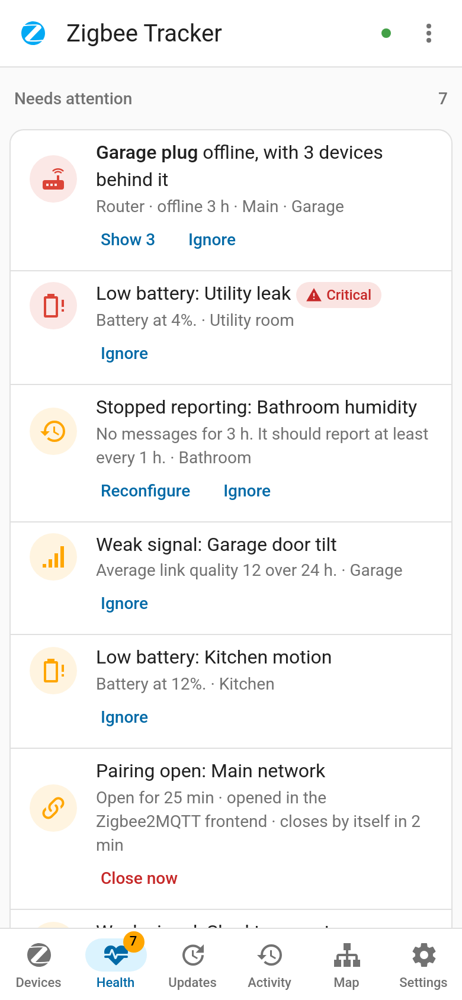<br><b>On a phone</b>: problems first, tabs at the bottom</td>
    <td width="50%" valign="top">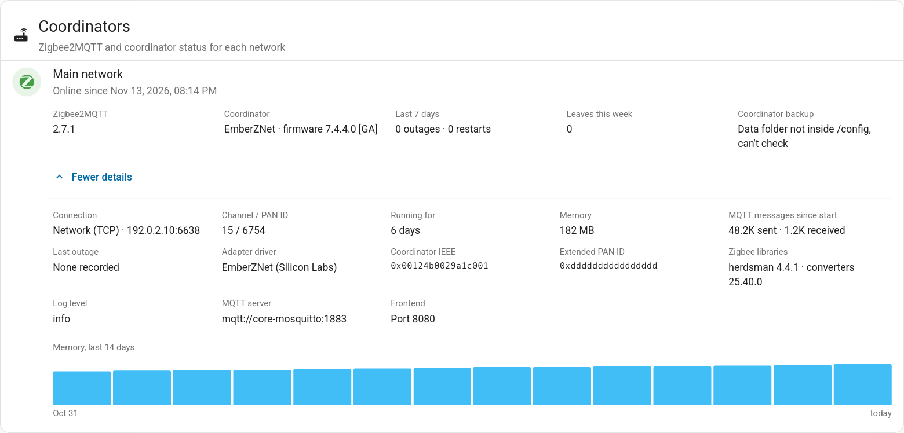<br><b>Coordinators</b>: connection, versions and Zigbee2MQTT memory</td>
  </tr>
</table>

The screenshots use made-up demo devices. More are in the [wiki](https://github.com/tempus2016/z2m-device-tracker/wiki).

## Step 1: install the app

The app is what you need. It comes from the App store, not the Marketplace.

[](https://my.home-assistant.io/redirect/supervisor_add_addon_repository/?repository_url=https%3A%2F%2Fgithub.com%2Ftempus2016%2Fz2m-device-tracker)

1. Settings → Apps → App store → ⋮ → Repositories, add `https://github.com/tempus2016/z2m-device-tracker`.
2. Install **Z2M Device Tracker** and start it. It needs the Mosquitto broker (or another MQTT broker set up in HA) for Zigbee2MQTT.
3. Open **Zigbee Tracker** from the sidebar.

If your Zigbee2MQTT uses a different base topic, or you run more than one instance, set `base_topics` in the app's configuration. See the app's Documentation tab for every option.

### ZHA and Matter (beta)

The app reads Zigbee2MQTT by default. Three switches in the app's configuration choose what it reads, and any mix can be on: `zigbee2mqtt` (on), `zha` and `matter` (both off). Turn one on and restart the app. ZHA and Matter come through Home Assistant and need no MQTT broker; each shows as its own network next to the others.

- **ZHA**: device history, last seen, offline and battery alerts, signal, the mesh map and the radio channel view.
- **Matter**, over Thread or Wi-Fi: device history, last seen, offline and battery alerts, the learned rhythm and a page per device. With Home Assistant's Matter Server app 9 or newer it also reads each device's role and the Thread links for the map. Nothing is ever sent to Matter devices.

Parts that need Zigbee2MQTT stay with the Zigbee2MQTT devices: firmware updates, reporting settings, pairing, bindings and the broker pages. Both are new, so please report anything that looks wrong. The app's Documentation tab has the details.

### Home Assistant Container (Docker)

Home Assistant Container has no App store, so the app runs as its own Docker container instead: `ghcr.io/tempus2016/z2m-device-tracker` (amd64 and arm64). Without a Supervisor it needs a few settings the App store would fill in for you:

| Variable | What it is |
| --- | --- |
| `MQTT_HOST`, `MQTT_PORT`, `MQTT_USER`, `MQTT_PASS` | The broker Zigbee2MQTT uses. `MQTT_SSL=true` for TLS. |
| `HA_URL` | Home Assistant's address, like `http://192.168.1.10:8123`. |
| `HA_TOKEN` | A long-lived access token: your HA profile → Security → Long-lived access tokens. |
| `UI_PASSWORD` | Password for the web UI, 8 characters or more. The UI stays locked until it's set. |
| `TZ` | Your time zone, like `Europe/London`. |

Start from [`docker/compose.yaml`](docker/compose.yaml):

```yaml
services:
  z2m-tracker:
    image: ghcr.io/tempus2016/z2m-device-tracker:latest
    restart: unless-stopped
    ports:
      - "8099:8099"
    environment:
      TZ: Europe/London
      MQTT_HOST: 192.168.1.10
      HA_URL: http://192.168.1.10:8123
      HA_TOKEN: "<long-lived access token>"
      UI_PASSWORD: "<a password>"
    volumes:
      - ./data:/data
      - /path/to/homeassistant/config:/homeassistant:ro
```

- **The web UI** is at `http://<docker host>:8099`. Sign in with `UI_PASSWORD`. To show it inside Home Assistant, add a **Webpage** dashboard pointing at that address (it signs in once per browser, and needs the same host as Home Assistant or its own tab).
- **Settings** you change in the UI are saved to `/data/options.json`. You can also edit that file and restart; it takes the same options as the app's Documentation tab ([DOCS.md](z2m_tracker/DOCS.md)).
- **Home Assistant's config folder** (read-only) is optional. It lets the first start import device history from Zigbee2MQTT's files and HA's registries.
- **The integration** (step 2) works the same, but it can't find the app by itself. Enter the app URL, like `http://192.168.1.10:8099`, and the **API token**: run `docker exec z2m-tracker cat /data/api_token` and paste the result. The dashboard cards open the app at `/app/...`, which only exists with the App store: set the card's `panel` option to your Webpage dashboard's path, like `/z2m-tracker`.

To build the image yourself: `docker build -f docker/Dockerfile -t z2m-tracker .` from the repository root.

## Step 2: install the integration (optional)

Do this once the app from step 1 is installed and running. The integration is in the Home Assistant Marketplace:

[](https://my.home-assistant.io/redirect/marketplace_repository/?owner=tempus2016&repository=z2m-device-tracker&category=integration)

1. Go to **Settings → Marketplace**, search for **Z2M Device Tracker**, install it and restart Home Assistant. The button above opens the right page.
2. Settings → Devices & services → Add integration → **Z2M Device Tracker**. The app's address is filled in for you.

On Home Assistant older than 2026.11, the Marketplace is still HACS: open HACS, search for **Z2M Device Tracker** and choose **Download**.

If it doesn't show up in the search, the Marketplace may not have refreshed its list yet. Add it by hand: Marketplace (or HACS) → ⋮ → Custom repositories, add `https://github.com/tempus2016/z2m-device-tracker` as **Integration**, then carry on from step 1.

The integration also lists the app's problems in **Settings → Repairs**, and clears each one when it's fixed. Device problems have a **Fix** button with the actions that suit them: restore or accept a lost binding, record a battery change, reconfigure, install a firmware update, or mute the check for 24 hours or until you unmute it. Critical devices offline, offline Zigbee2MQTT networks and coordinator backup problems get their own wording and always make the list. Turn Repairs off with **Show problems in HA Repairs** in the app's settings or in the integration's options. They also stay empty while **Send alerts** is off in the app.

The battery and maintenance calendars and to-do lists make Home Assistant add **Calendar** and **To-do** to the sidebar. If you don't want them, turn off **Battery and maintenance calendars and to-do lists** in the integration's options (Settings → Devices & services → Z2M Device Tracker → ⚙), then restart Home Assistant. To keep the lists and only hide the sidebar items, long-press the Home Assistant title at the top of the sidebar.

It also adds actions you can use in automations and scripts: `z2m_tracker.battery_replaced`, `z2m_tracker.mute_device`, `z2m_tracker.run_network_scan`, `z2m_tracker.reconfigure`, `z2m_tracker.ota_update`, `z2m_tracker.add_note`, `z2m_tracker.pause_alerts` and `z2m_tracker.resume_alerts`. For example, record a battery change when you scan an NFC tag stuck on the device:

```yaml
triggers:
  - trigger: tag
    tag_id: hall-motion
actions:
  - action: z2m_tracker.battery_replaced
    data:
      device_id: 4f1c9e0a7b2d4c6e8f01a2b3c4d5e6f7
```

Add the card to a dashboard:

```yaml
type: custom:z2m-tracker-card
title: Zigbee devices
max_items: 5
```

Three more cards read the same data. Each has a visual editor, and tapping a device opens it in the Zigbee Tracker sidebar.

Battery devices, lowest first. Bars turn red at the app's low-battery threshold (`battery_alert_percent`, or the device's own limit). `show_all: true` ignores `max_items`.

```yaml
type: custom:z2m-tracker-battery-card
title: Batteries
max_items: 8
show_all: false
```

How many devices need attention, are worth a look or are fine, then the top issues. `show_info: false` lists only the ones that need attention.

```yaml
type: custom:z2m-tracker-health-card
title: Zigbee health
max_items: 5
show_info: true
```

Devices, routers, offline devices and single-point-of-failure routers, plus each network's channel (and whether it overlaps your Wi-Fi), coordinator backup age and last scan.

```yaml
type: custom:z2m-tracker-network-card
title: Zigbee network
show_weak_spots: true
```

## Contributing

Bug reports and ideas go in the [issues](https://github.com/tempus2016/z2m-device-tracker/issues). If you use the integration, attach its diagnostics: Settings → Devices & services → Z2M Device Tracker → ⋮ → Download diagnostics. Device addresses, names, notes and your notify service are removed from the file. For code, see [CONTRIBUTING.md](CONTRIBUTING.md), and report security problems privately as described in [SECURITY.md](SECURITY.md).

## Credits

The battery library is from [Battery Notes](https://github.com/andrew-codechimp/HA-Battery-Notes) by Andrew Jackson (MIT licence, see `z2m_tracker/app/battery_library.LICENSE`).

## Licence

MIT
