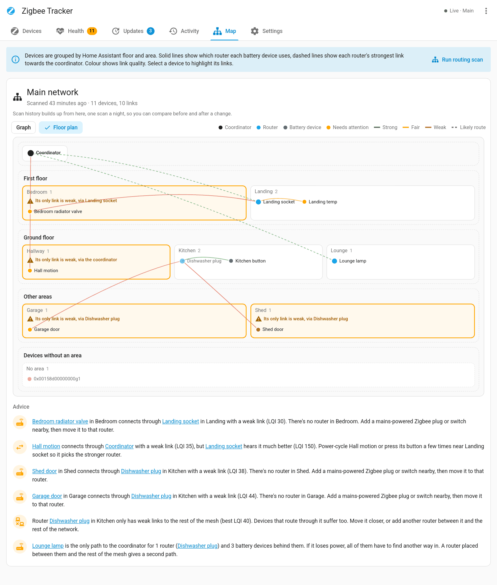
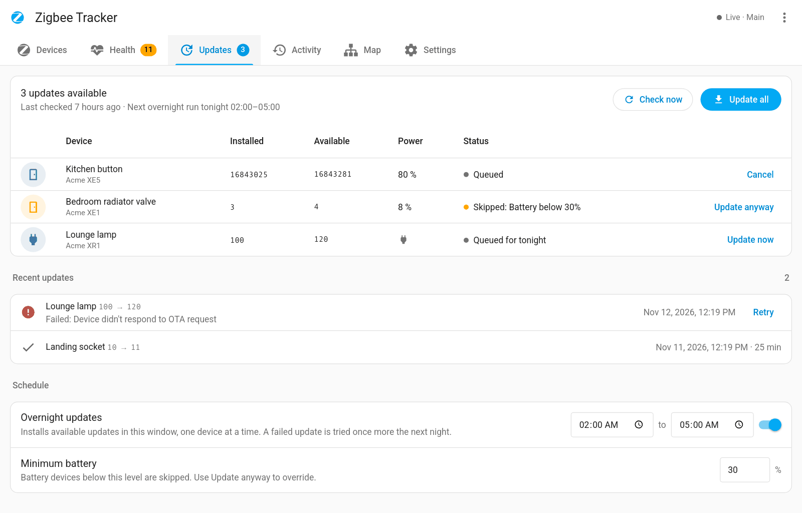
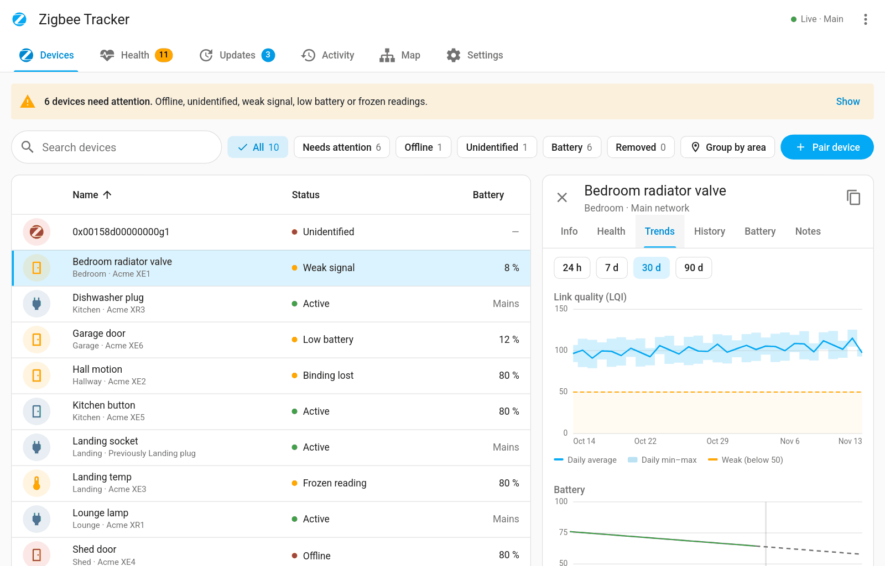
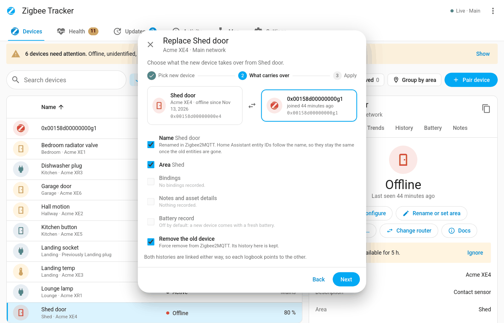

<h1 align="center">Z2M Device Tracker</h1>

<p align="center">
  <strong>History, health and alerts for every Zigbee2MQTT device.</strong>
</p>

<p align="center">
  <a href="https://github.com/tempus2016/z2m-device-tracker/releases"></a>
  <a href="https://hacs.xyz/docs/faq/custom_repositories/"></a>
  <a href="https://github.com/tempus2016/z2m-device-tracker/blob/main/LICENSE"></a>
  
  
</p>

<p align="center">
  <a href="https://github.com/tempus2016/z2m-device-tracker/actions/workflows/lint.yml"></a>
  <a href="https://github.com/tempus2016/z2m-device-tracker/actions/workflows/app.yml"></a>
  <a href="https://github.com/tempus2016/z2m-device-tracker/actions/workflows/hassfest.yml"></a>
  <a href="https://github.com/tempus2016/z2m-device-tracker/actions/workflows/hacs.yml"></a>
  <a href="https://github.com/tempus2016/z2m-device-tracker/actions/workflows/codeql.yml"></a>
  <a href="https://github.com/tempus2016/z2m-device-tracker/commits/main"></a>
</p>

A Home Assistant app and integration that keeps a full history of every device on your Zigbee2MQTT networks, watches their health, and tells you when something needs attention.

Ever had a device show up as `0x30eb5affff5cf5ca` and had no idea what it used to be? This records every name, model, area and change, and keeps it after the device is gone.

<p align="center"></p>

It has two parts, both in this repository:

| Part | What it does | Install from |
| --- | --- | --- |
| **App** (`z2m_tracker/`) | Listens to Zigbee2MQTT over MQTT, stores the history and runs the web interface in the sidebar. | Settings → Apps → App store → Repositories |
| **Integration** (`custom_components/z2m_tracker/`) | Optional. Adds summary sensors, a battery to-do list and calendar, a dashboard card and Repairs issues. | HACS (custom repository) |

## Features

- **Device history**: names, renames, model, firmware, area, joins, leaves and removals, with notes and asset details.
- **Health checks and alerts**: offline, silent, frozen readings, weak or dropping signal, low battery, failed interviews, unidentified devices. Alerts go to HA notifications, events or a notify service. Pause them all during planned work.
- **More checks**: flapping devices, chatty devices, fast battery drain, lost bindings, single points of failure (routers), and a missing, stale or mismatched coordinator backup. They show in Health and only notify once you turn them on.
- **Bindings and traffic**: each device's current and lost bindings with a history of changes and a Restore button for each lost one, its message rates, and Zigbee2MQTT's own message, leave and address-change counters.
- **Coordinator health**: Zigbee2MQTT version, coordinator firmware, uptime, restarts, outages and coordinator backup, and an alert when a network goes offline.
- **Radio channels**: shows your Zigbee channels against your 2.4 GHz Wi-Fi channels and warns about overlap.
- **Network map**: interactive map with advice on which router a device should use and which routers are a single point of failure, nightly routing scans, a before/after comparison between scans, and a floor-plan layout that groups devices by Home Assistant floor and area. Click a group in the legend (routers, battery devices, needs attention) to show only those devices.
- **Device actions**: pair through a chosen router, move a device to another router, reconfigure, rename, set area, OTA updates. Names and areas stay in step with Home Assistant: a change made there shows in the app within seconds.
- **Firmware updates**: one list of every device with an update, installed and available versions, update all one device at a time, an optional overnight window that skips low batteries, and a log of past updates.
- **Replace a device**: swap a dead device for a new one in three steps. The new device takes over its name, area, bindings, notes and, if you want, battery record, the old one is removed from Zigbee2MQTT, and both histories are linked.
- **Batteries**: battery type and count (built-in library from Battery Notes), replacement records, estimates and a shopping list. With the integration, the shopping list is a Home Assistant to-do list (tick an item to mark those batteries replaced) and a calendar shows each predicted replacement date.
- **Long-range trends**: each device's link quality and battery over 24 hours, 7, 30 or 90 days, with a daily min–max band, battery changes and a projection to when the battery runs low.
- **Home Assistant entities**: MQTT discovery sensors attached to each Zigbee2MQTT device for use in automations.
- **Actions for automations** (integration): record a battery change, mute a device, run a network scan, reconfigure, start a firmware update, add to a device's note, pause and resume alerts. Pick devices by name.
- **Your language**: the sidebar follows the language in your Home Assistant profile, or one you pick in Settings. English ships today; [CONTRIBUTING.md](CONTRIBUTING.md) explains how to add a translation.
- Weekly summary, temporary ignore, backup and restore, CSV export.

## Screenshots

<table>
  <tr>
    <td width="50%" valign="top"><br><b>Device history</b>: a device's names and logbook, kept after it leaves</td>
    <td width="50%" valign="top"><br><b>Health</b>: what needs attention, and what's worth a look</td>
  </tr>
  <tr>
    <td width="50%" valign="top"><br><b>Network map</b>: routing, link quality and advice on better routers</td>
    <td width="50%" valign="top"><br><b>Radio channels</b>: Zigbee channels against your Wi-Fi channels</td>
  </tr>
  <tr>
    <td width="50%" valign="top"><br><b>Floor plan</b>: devices by floor and area, with weak areas flagged</td>
    <td width="50%" valign="top"><br><b>Firmware updates</b>: every update in one list, with an overnight window</td>
  </tr>
  <tr>
    <td width="50%" valign="top"><br><b>Trends</b>: link quality and battery over up to 90 days</td>
    <td width="50%" valign="top"><br><b>Replace a device</b>: the new one takes over name, area and setup</td>
  </tr>
</table>

The screenshots use made-up demo devices. More are in the [wiki](https://github.com/tempus2016/z2m-device-tracker/wiki).

## Install the app

[](https://my.home-assistant.io/redirect/supervisor_add_addon_repository/?repository_url=https%3A%2F%2Fgithub.com%2Ftempus2016%2Fz2m-device-tracker)

1. Settings → Apps → App store → ⋮ → Repositories, add `https://github.com/tempus2016/z2m-device-tracker`.
2. Install **Z2M Device Tracker** and start it. It needs the Mosquitto broker (or another MQTT broker set up in HA).
3. Open **Zigbee Tracker** from the sidebar.

If your Zigbee2MQTT uses a different base topic, or you run more than one instance, set `base_topics` in the app's configuration. See the app's Documentation tab for every option.

## Install the integration (optional)

[](https://my.home-assistant.io/redirect/hacs_repository/?owner=tempus2016&repository=z2m-device-tracker&category=integration)

1. HACS → ⋮ → Custom repositories, add `https://github.com/tempus2016/z2m-device-tracker` as **Integration**.
2. Download **Z2M Device Tracker** and restart Home Assistant.
3. Settings → Devices & services → Add integration → **Z2M Device Tracker**. The app's address is filled in for you.

The integration also lists the app's problems in **Settings → Repairs**, and clears each one when it's fixed. Device problems have a **Fix** button with the actions that suit them: restore or accept a lost binding, record a battery change, reconfigure, install a firmware update, or mute the check for 24 hours or until you unmute it. Turn Repairs off in the integration's options.

It also adds actions you can use in automations and scripts: `z2m_tracker.battery_replaced`, `z2m_tracker.mute_device`, `z2m_tracker.run_network_scan`, `z2m_tracker.reconfigure`, `z2m_tracker.ota_update`, `z2m_tracker.add_note`, `z2m_tracker.pause_alerts` and `z2m_tracker.resume_alerts`. For example, record a battery change when you scan an NFC tag stuck on the device:

```yaml
triggers:
  - trigger: tag
    tag_id: hall-motion
actions:
  - action: z2m_tracker.battery_replaced
    data:
      device_id: 4f1c9e0a7b2d4c6e8f01a2b3c4d5e6f7
```

Add the card to a dashboard:

```yaml
type: custom:z2m-tracker-card
title: Zigbee devices
max_items: 5
```

Three more cards read the same data. Each has a visual editor, and tapping a device opens it in the Zigbee Tracker sidebar.

Battery devices, lowest first. Bars turn red at the app's low-battery threshold (`battery_alert_percent`, or the device's own limit). `show_all: true` ignores `max_items`.

```yaml
type: custom:z2m-tracker-battery-card
title: Batteries
max_items: 8
show_all: false
```

How many devices need attention, are worth a look or are fine, then the top issues. `show_info: false` lists only the ones that need attention.

```yaml
type: custom:z2m-tracker-health-card
title: Zigbee health
max_items: 5
show_info: true
```

Devices, routers, offline devices and single-point-of-failure routers, plus each network's channel (and whether it overlaps your Wi-Fi), coordinator backup age and last scan.

```yaml
type: custom:z2m-tracker-network-card
title: Zigbee network
show_weak_spots: true
```

## Contributing

Bug reports and ideas go in the [issues](https://github.com/tempus2016/z2m-device-tracker/issues). If you use the integration, attach its diagnostics: Settings → Devices & services → Z2M Device Tracker → ⋮ → Download diagnostics. Device addresses, names, notes and your notify service are removed from the file. For code, see [CONTRIBUTING.md](CONTRIBUTING.md), and report security problems privately as described in [SECURITY.md](SECURITY.md).

## Credits

The battery library is from [Battery Notes](https://github.com/andrew-codechimp/HA-Battery-Notes) by Andrew Jackson (MIT licence, see `z2m_tracker/app/battery_library.LICENSE`).

## Licence

MIT
