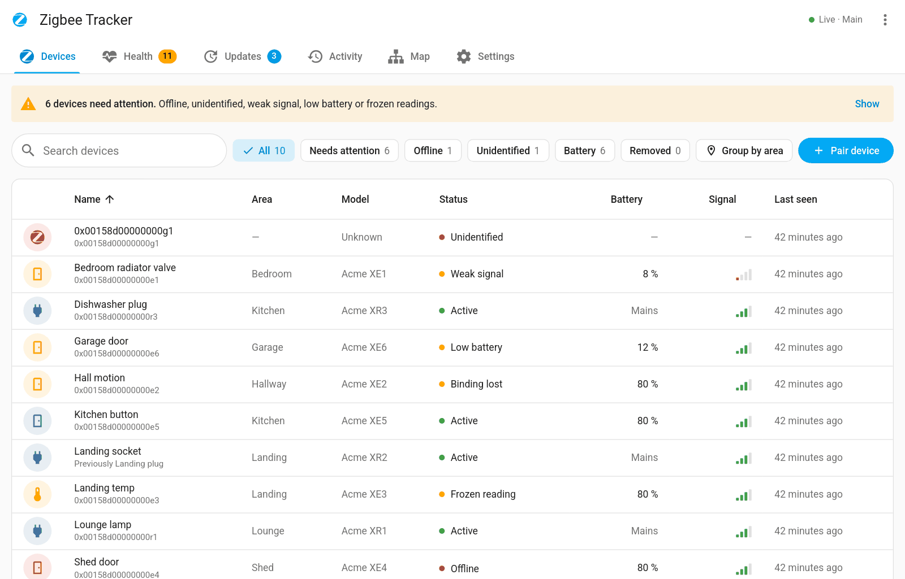
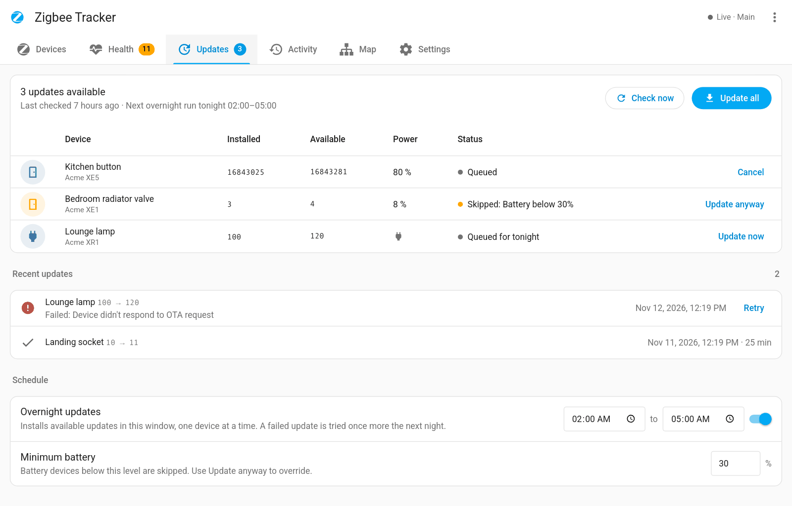
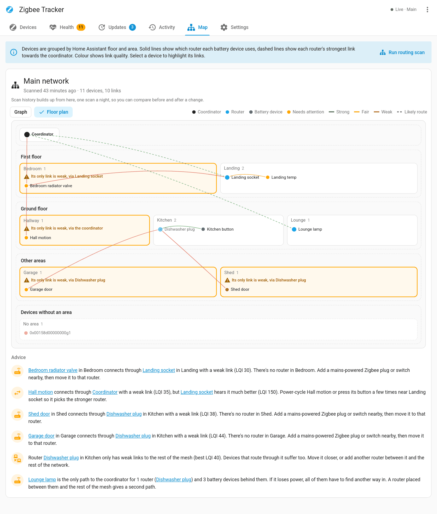

# Z2M Device Tracker

History, health checks and alerts for every device on your Zigbee2MQTT networks.

Ever had a device show up as `0x30eb5affff5cf5ca` and had no idea what it used to be? This app records every name, model, area and change, keeps the record after the device is gone, and tells you when something needs attention.

## What you get

- **Device history**: every name, rename, model, firmware, area, join, leave and removal, with notes and asset details. Kept after a device leaves.
- **Health checks and alerts**: offline, silent, frozen readings, weak or dropping signal, low battery, lost bindings, failed interviews, flapping and chatty devices, fast battery drain, single points of failure and coordinator backups. Alerts go to Home Assistant notifications, events or any notify service.
- **Firmware updates**: every device with an update in one list, installed one at a time, with an optional overnight window that skips low batteries.
- **Network map**: which router each device uses and how strong the link is, as a graph or a floor plan by Home Assistant floor and area, with advice on better routers and nightly routing scans.
- **Trends**: each device's link quality and battery over up to 90 days, with a projection of when the battery runs low.
- **Device actions**: pair through a chosen router, move a device to a closer router, rename, set area, reconfigure, restore lost bindings, and replace a dead device with a new one.
- **Batteries**: battery types from a built-in library, replacement records, estimates and a shopping list that counts your spares.
- **Coordinator and radio**: Zigbee2MQTT and coordinator versions, uptime, outages and backups, and your Zigbee channels checked against your Wi-Fi.
- **Home Assistant entities**: tracker sensors added to each Zigbee2MQTT device, for automations.
- Names and areas stay in step with Home Assistant. The sidebar follows your profile language.

| Firmware updates | Floor plan |
| --- | --- |
|  |  |

## Before you start

- Zigbee2MQTT (one or more instances) publishing to the MQTT broker Home Assistant uses, normally the **Mosquitto broker** app.
- If your Zigbee2MQTT doesn't use the `zigbee2mqtt` base topic, or you run more than one, set `base_topics` on the **Configuration** tab.

## Getting started

1. Start the app. It connects to MQTT and reads your Zigbee2MQTT devices straight away.
2. Open **Zigbee Tracker** in the sidebar.
3. Once it has your device lists, the first start also imports what it can find in Zigbee2MQTT's and Home Assistant's files, so older names and removed devices show up too.

Every option is on the **Documentation** tab. Most can also be changed on the sidebar's **Settings** tab.

## Optional integration

The Z2M Device Tracker integration (from HACS) adds summary sensors, a battery to-do list and calendar, dashboard cards, actions for automations and fixable Repairs issues. See the [README](https://github.com/tempus2016/z2m-device-tracker#install-the-integration-optional).

## Help

- [Wiki](https://github.com/tempus2016/z2m-device-tracker/wiki): every tab, check and setting explained.
- [Issues](https://github.com/tempus2016/z2m-device-tracker/issues): bugs and ideas.

The screenshots use made-up demo devices.
